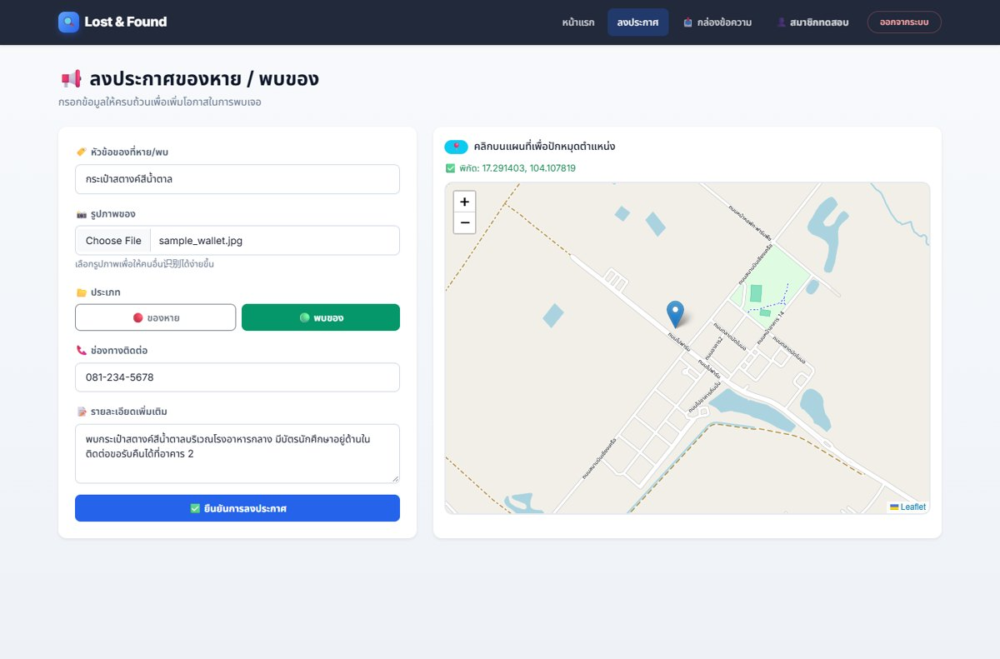
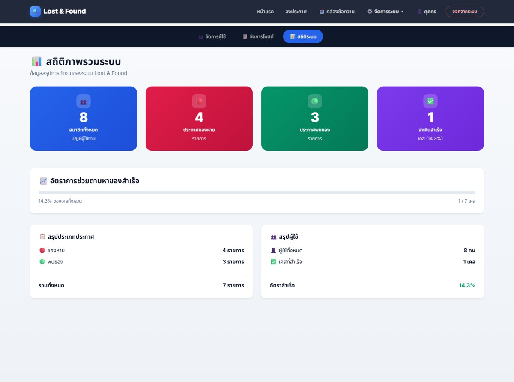
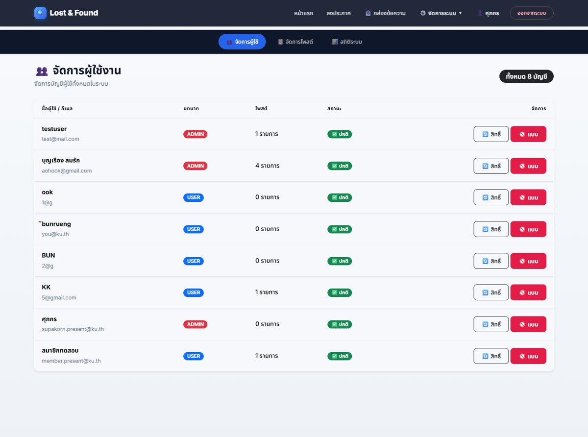
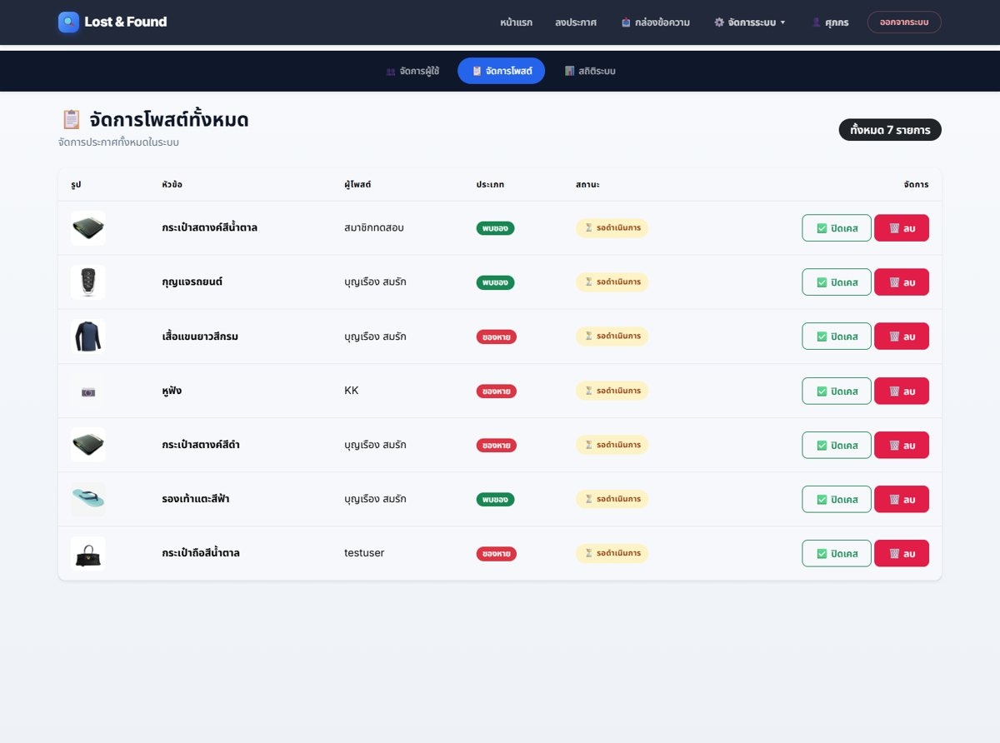
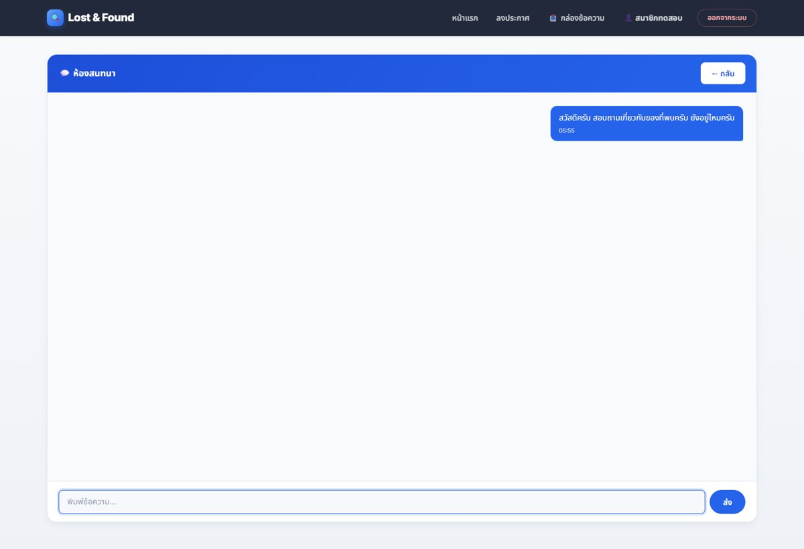

# Lost & Found — เว็บไซต์พบเจอและตามหาของหาย

เว็บแอปพลิเคชันสำหรับประกาศของหายและของที่พบภายในมหาวิทยาลัย รองรับการค้นหาและกรองประกาศ การปักหมุดตำแหน่งบนแผนที่ การจัดการประกาศ และการสนทนาแบบเรียลไทม์ระหว่างผู้พบกับเจ้าของ

> โครงงานปริญญานิพนธ์ หลักสูตรวิทยาศาสตรบัณฑิต สาขาวิชาวิทยาการคอมพิวเตอร์<br>
> ภาควิชาวิทยาการคอมพิวเตอร์และสารสนเทศ คณะวิทยาศาสตร์และวิศวกรรมศาสตร์<br>
> มหาวิทยาลัยเกษตรศาสตร์ วิทยาเขตเฉลิมพระเกียรติ จังหวัดสกลนคร

**GitHub:** https://github.com/supakornbun45/Lost-Found-Web

## ผู้จัดทำ

| | |
|---|---|
| **นิสิต** | นายศุภกร อินทรพาณิชย์ |
| **รหัสนิสิต** | 6640204472 |
| **อาจารย์ที่ปรึกษา** | ผู้ช่วยศาสตราจารย์ ดร.จารุวัฒน์ ไพใหล |

## วิดีโอแนะนำโครงงาน

**[ดูวิดีโอแนะนำโครงงาน (ไฟล์ในโปรเจกต์)](video/LostAndFound_Demo_Draft.mp4)**

> วิดีโอความยาว 5:14 นาที ความละเอียด 1080p พร้อมเสียงบรรยายภาษาไทย
> หากต้องการใช้ YouTube ให้อัปโหลดไฟล์นี้แล้วเปลี่ยนลิงก์ด้านบนเป็นลิงก์ YouTube
> สคริปต์ คำอธิบาย YouTube และไฟล์ซับไตเติลอยู่ในโฟลเดอร์ [`video/`](video/README.md)

## ภาพรวมโครงงาน

ภายในมหาวิทยาลัยมีนักศึกษา บุคลากร และบุคคลภายนอกใช้พื้นที่ร่วมกันจำนวนมาก จึงเกิดการลืมหรือทำสิ่งของสูญหายได้บ่อยครั้ง การประกาศตามหาบนโซเชียลมีเดียมีข้อจำกัด เช่น ประกาศถูกดันตกจนค้นหาได้ยาก ไม่มีตัวกรองตามพิกัดหรือช่วงวันที่ และไม่มีสถานะการติดตามที่ชัดเจน

ระบบนี้จึงถูกพัฒนาขึ้นเป็นช่องทางกลางสำหรับประกาศของหายและของที่พบ โดยผู้ใช้สามารถแนบรูปภาพ ระบุตำแหน่งบนแผนที่ ค้นหาและกรองประกาศ ติดตามสถานะ และสนทนากับอีกฝ่ายได้ทันที

## ฟีเจอร์หลัก

### ผู้ใช้ทั่วไป (Guest)
- ดูประกาศของหายและของที่พบได้โดยไม่ต้องเข้าสู่ระบบ
- ค้นหาด้วยคำสำคัญ และกรองตามประเภท (ของหาย/ของที่พบ)
- เปิดดูรายละเอียด ตำแหน่งบนแผนที่ และช่องทางติดต่อ
- สมัครสมาชิกเพื่อเริ่มลงประกาศ

### สมาชิก (Member)
- สมัครสมาชิกและเข้าสู่ระบบด้วย JWT
- สร้างประกาศพร้อมรูปภาพ หัวข้อ รายละเอียด ประเภท ช่องทางติดต่อ และปักหมุดแผนที่
- จัดการประกาศของตนเอง: แก้ไข เปลี่ยนสถานะเป็นส่งคืนแล้ว หรือลบ
- ค้นหาและกรองประกาศ พร้อมการแบ่งหน้า
- สนทนาแบบเรียลไทม์ผ่าน Socket.io

### ผู้ดูแลระบบ (Admin / Super Admin)
- จัดการสมาชิก: ระงับ/ปลดแบน พร้อมระบุเหตุผล และแต่งตั้งสิทธิ์
- จัดการประกาศทั้งหมด: เปลี่ยนสถานะหรือลบประกาศ
- ดูรายงานสถิติภาพรวมและอัตราความสำเร็จในการส่งคืน
- ตรวจสอบประวัติการทำงานของผู้ดูแลผ่าน Audit Log

## หน้าจอระบบ

| หน้าหลักและค้นหา | สร้างประกาศพร้อมแผนที่ |
|---|---|
|  |  |

| แดชบอร์ดสถิติ | จัดการสมาชิก |
|---|---|
|  |  |

| จัดการประกาศ | ห้องสนทนาเรียลไทม์ |
|---|---|
|  |  |

## เทคโนโลยีที่ใช้

| ส่วน | เทคโนโลยี |
|---|---|
| Frontend | React 19, React Router, Bootstrap 5, React-Leaflet, Axios, Socket.io-client |
| Backend | Node.js, Express 5, Socket.io, Multer, MySQL2 |
| Authentication | JWT, bcryptjs |
| Database | MySQL / MariaDB (XAMPP) |
| Tools | Visual Studio Code, Git, GitHub |

## โครงสร้างโปรเจกต์

```text
lost-and-found-app/
├── client/                 # React frontend
│   ├── public/
│   └── src/
│       ├── components/     # Navbar, Footer, Pagination, MapModal
│       ├── pages/          # Home, Login, Register, CreatePost, Chat, Admin...
│       └── utils/          # auth, labels, leaflet, ui
├── server/                 # Express + Socket.io backend
│   ├── middleware/         # JWT authentication / role guard
│   ├── routes/             # auth, posts, chat, admin
│   ├── utils/              # audit log
│   ├── db.js
│   ├── schema.js
│   └── index.js
├── database/
│   └── lost_found.sql      # โครงสร้างฐานข้อมูล
├── docs/screenshots/       # ภาพหน้าจอสำหรับ README
└── video/                  # สคริปต์และวิดีโอแนะนำโครงงาน
```

## การติดตั้งและรันโปรเจกต์

### 1. เตรียมฐานข้อมูล

เปิด MySQL จาก XAMPP แล้ว import ไฟล์ `database/lost_found.sql` ผ่าน phpMyAdmin หรือใช้คำสั่ง:

```bash
mysql -u root -p < database/lost_found.sql
```

ฐานข้อมูลจะถูกสร้างเป็น `lost_and_found_db`

### 2. ตั้งค่า Environment

คัดลอกไฟล์ตัวอย่างแล้วแก้ไขค่าให้ตรงกับเครื่องของคุณ:

```bash
cd server
copy .env.example .env
```

ตัวอย่างค่าที่ต้องตั้ง:

```env
DB_HOST=localhost
DB_USER=root
DB_PASSWORD=
DB_NAME=lost_and_found_db
PORT=5000
JWT_SECRET=replace_with_a_long_random_secret
```

> **หมายเหตุ:** ห้าม commit ไฟล์ `server/.env` ขึ้น GitHub เพราะมีรหัสผ่านฐานข้อมูลและ JWT Secret

### 3. รัน Backend

```bash
cd server
npm install
npm start
```

เซิร์ฟเวอร์จะทำงานที่ `http://localhost:5000`

### 4. รัน Frontend

เปิด terminal อีกหน้าต่าง:

```bash
cd client
npm install
npm start
```

เปิดเบราว์เซอร์ที่ `http://localhost:3000`

### 5. ตั้งสิทธิ์ผู้ดูแลระบบ

1. สมัครสมาชิกผ่านหน้าเว็บ
2. เปลี่ยนสิทธิ์ในฐานข้อมูล:

```sql
UPDATE users SET role = 'admin' WHERE email = 'your-email@example.com';
```

หรือแต่งตั้งเป็น `superadmin` สำหรับผู้ดูแลสูงสุด

## API หลัก

| Method | Endpoint | คำอธิบาย |
|---|---|---|
| POST | `/api/auth/register` | สมัครสมาชิก |
| POST | `/api/auth/login` | เข้าสู่ระบบ |
| GET | `/api/auth/me` | ข้อมูลผู้ใช้ปัจจุบัน |
| PUT | `/api/auth/profile` | แก้ไขโปรไฟล์ |
| PUT | `/api/auth/change-password` | เปลี่ยนรหัสผ่าน |
| GET | `/api/posts/all` | ดูประกาศทั้งหมด (ค้นหา/กรอง/แบ่งหน้า) |
| GET | `/api/posts/get-post/:id` | ดูประกาศรายการเดียว |
| POST | `/api/posts/create` | สร้างประกาศพร้อมรูปภาพ (ต้องเข้าสู่ระบบ) |
| GET | `/api/posts/my-posts/:userId` | ดูประกาศของสมาชิก |
| PUT | `/api/posts/update/:id` | แก้ไขประกาศ |
| PUT | `/api/posts/update-status/:id` | เปลี่ยนสถานะประกาศ |
| DELETE | `/api/posts/delete/:id` | ลบประกาศ |
| POST | `/api/chat/get-or-create` | เปิดหรือดึงห้องสนทนาของประกาศ |
| GET | `/api/chat/list/:userId` | ดูรายการบทสนทนาของผู้ใช้ |
| GET | `/api/chat/messages/:conversationId` | ดูข้อความในห้อง |
| POST | `/api/chat/send` | ส่งข้อความ |
| GET | `/api/admin/users` | ดูรายชื่อสมาชิก (Admin) |
| PUT | `/api/admin/users/ban/:id` | ระงับ/ปลดแบนสมาชิก (Admin) |
| PUT | `/api/admin/users/role/:id` | เปลี่ยนสิทธิ์ผู้ใช้ (Admin) |
| GET | `/api/admin/posts` | ดูประกาศทั้งหมด (Admin) |
| DELETE | `/api/admin/posts/:id` | ลบประกาศ (Admin) |
| PUT | `/api/admin/posts/status/:id` | ปิดประกาศ (Admin) |
| GET | `/api/admin/stats-summary` | ดูสถิติภาพรวม (Admin) |
| GET | `/api/admin/logs` | ดู Audit Log (Admin) |

## วิดีโอและเอกสารประกอบ

- [`video/LostAndFound_Presentation.pptx`](video/LostAndFound_Presentation.pptx) — สไลด์นำเสนอสำหรับอัดเสียงบรรยาย
- [`video/VIDEO_SCRIPT.md`](video/VIDEO_SCRIPT.md) — สคริปต์บรรยายพร้อมลำดับเวลา
- [`video/YOUTUBE_DESCRIPTION.txt`](video/YOUTUBE_DESCRIPTION.txt) — คำอธิบายและ chapters สำหรับ YouTube
- [`video/LostAndFound_Demo_Draft.mp4`](video/LostAndFound_Demo_Draft.mp4) — วิดีโอฉบับร่าง (AI narration, 1080p)
- [`video/LostAndFound_Demo_Draft.srt`](video/LostAndFound_Demo_Draft.srt) — ไฟล์ซับไตเติล

## License

โปรเจกต์นี้จัดทำเพื่อการศึกษาในรายวิชาโครงงานปริญญานิพนธ์
